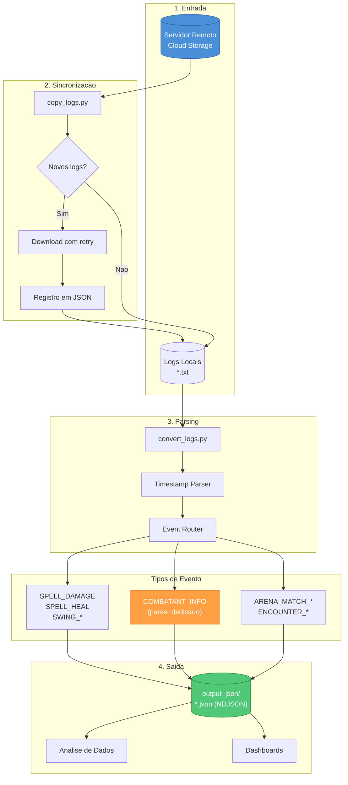

# WoW Arena Logs ETL Pipeline

[](https://www.python.org/downloads/)
[](LICENSE)
[](https://github.com/astral-sh/ruff)

Pipeline ETL para download, parsing e conversão de logs de combate do World of Warcraft (Arena/PvP) em formato JSON estruturado para análise de dados.

---

## Visao Geral

Este projeto automatiza o fluxo completo de coleta e transformacao de logs de combate:

1. **Download** - Sincroniza logs de um servidor remoto
2. **Parsing** - Interpreta eventos do Combat Log (CLEU)
3. **Conversao** - Gera NDJSON estruturado para analise

---

## Fluxo de Processamento



---

## Arquitetura

```
dlLogs/
├── scripts/                    # Codigo principal
│   ├── convert_logs.py         # Conversor TXT → NDJSON
│   ├── copy_logs.py            # Sincronizador de logs
│   ├── parser_combatant_info.py # Parser especializado
│   ├── interface_copy_logs.py  # Interface TUI (Textual)
│   ├── url.py                  # Configuracao de endpoint
│   ├── doc/                    # Documentacao tecnica
│   │   ├── full_documentation.md
│   │   └── unitflag.md
│   └── tests/                  # Suite de testes
│       ├── test_*.py
│       └── amostras/
├── logs/                       # Logs baixados (*.txt)
├── output_json/                # Saida convertida (*.json)
├── requirements.txt
└── README.md
```

---

## Instalacao

### Pre-requisitos

- Python 3.11 ou superior
- pip (gerenciador de pacotes)

### Setup

```bash
# Clonar repositorio
git clone https://github.com/ValadaresX/dlLogs.git
cd dlLogs

# Criar ambiente virtual (recomendado)
python -m venv .venv
source .venv/bin/activate  # Linux/Mac
.venv\Scripts\activate     # Windows

# Instalar dependencias
pip install -r requirements.txt
```

### Configuracao

Crie o arquivo `scripts/url.py` com o endpoint do servidor:

```python
url_base: str = "https://seu-servidor.com/logs/"
```

---

## Uso

### 1. Sincronizar Logs (Download)

```bash
# Execucao unica
python scripts/copy_logs.py --once

# Loop continuo (verifica a cada 6-8 horas)
python scripts/copy_logs.py

# Dry-run (simula sem baixar)
python scripts/copy_logs.py --once --dry-run
```

### 2. Converter Logs para JSON

```bash
# Converter todos os logs
python scripts/convert_logs.py

# Converter apenas os 5 menores (teste rapido)
python scripts/convert_logs.py -5
```

### 3. Interface Grafica (TUI)

```bash
python scripts/interface_copy_logs.py
```

Atalhos:
- `R` - Forcar sincronizacao
- `L` - Limpar log
- `Q` - Sair

---

## Estrutura dos Dados

### Entrada (Combat Log)

```
1/2 15:30:45.123  SPELL_DAMAGE,Player-123-ABC,"PlayerName",0x511,0x0,...
```

### Saida (NDJSON)

```json
{
  "timestamp": 1704214245.123,
  "event": "SPELL_DAMAGE",
  "sourceGUID": "Player-123-ABC",
  "sourceName": "PlayerName",
  "sourceFlags": ["AFFILIATION_MINE", "REACTION_FRIENDLY", "CONTROL_PLAYER", "TYPE_PLAYER"],
  "spellId": 12345,
  "spellName": "Fireball",
  "spellSchool": 4,
  "spellSchoolNames": ["FIRE"],
  "amount": 15000,
  "critical": true,
  "lh": "a1b2c3d4"
}
```

---

## Eventos Suportados

| Categoria | Eventos |
|-----------|---------|
| **Dano** | `SPELL_DAMAGE`, `SWING_DAMAGE`, `RANGE_DAMAGE`, `ENVIRONMENTAL_DAMAGE` |
| **Cura** | `SPELL_HEAL`, `SPELL_PERIODIC_HEAL` |
| **Auras** | `SPELL_AURA_APPLIED`, `SPELL_AURA_REMOVED`, `SPELL_AURA_REFRESH` |
| **Cast** | `SPELL_CAST_START`, `SPELL_CAST_SUCCESS`, `SPELL_CAST_FAILED` |
| **Arena** | `ARENA_MATCH_START`, `ARENA_MATCH_END`, `COMBATANT_INFO` |
| **Outros** | `UNIT_DIED`, `SPELL_SUMMON`, `SPELL_INTERRUPT` |

---

## Testes

```bash
# Executar todos os testes
python -m pytest scripts/tests/ -v

# Executar teste especifico
python -m pytest scripts/tests/test_combatant_info.py -v

# Com cobertura
python -m pytest scripts/tests/ --cov=scripts --cov-report=term-missing
```

---

## Desenvolvimento

### Ferramentas

```bash
# Lint e formatacao
ruff check scripts/ --fix
ruff format scripts/

# Type checking
mypy scripts/
```

### Configuracao (pyproject.toml)

```toml
[tool.ruff]
line-length = 88
target-version = "py314"

[tool.mypy]
python_version = "3.14"
strict = true
```

---

## Performance

- **Multiprocessing**: Conversao paralela de arquivos
- **Streaming**: Memoria constante independente do tamanho do arquivo
- **LRU Cache**: Flags e timestamps cacheados para hot paths
- **Buffer otimizado**: Escrita em chunks de 2MB

---

## Licenca

Este projeto esta licenciado sob a [MIT License](LICENSE).

---

## Contribuicao

1. Fork o repositorio
2. Crie uma branch (`git checkout -b feature/nova-funcionalidade`)
3. Commit suas mudancas (`git commit -m 'Adiciona nova funcionalidade'`)
4. Push para a branch (`git push origin feature/nova-funcionalidade`)
5. Abra um Pull Request
